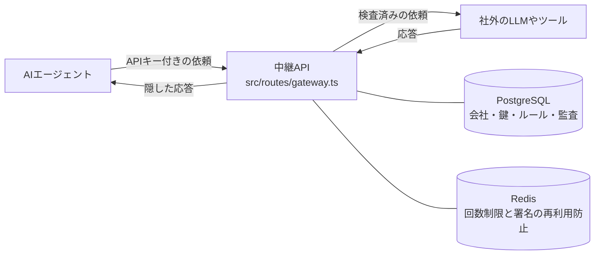
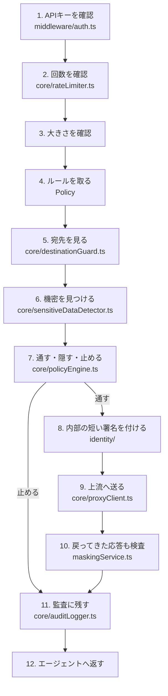

# コードの読み方

この文書は、ソースコードのファイル名を日本語に引き戻すための解説です。製品がやることは一つです。AIエージェントが社外へ出す依頼をいったん受け取り、危ない中身を隠すか止め、許可した宛先だけへ渡します。

## 全体の形

中継の中では、次の順に処理します。`src/routes/gateway.ts` の `POST /v1/gateway/proxy` がこの順番を持っています。

止めたときも、通したときも、最後に監査へ残します。本文そのものは残しません。

## コード名の対応

| コード上の名前 | 日本語 | 場所 | 何をするか |
| --- | --- | --- | --- |
| Tenant | 導入する会社 | `src/routes/tenants.ts` | 会社名、管理者メール、プランを作る。管理キーが必要 |
| ApiKey | 接続用の鍵 | `src/routes/apiKeys.ts` | `ask_` で始まる鍵を一度だけ見せ、保存するのはSHA-256のハッシュ |
| Policy | 送出ルール | `src/routes/policies.ts` | 許可ドメイン、禁止語、隠す規則、大きさ、回数、対象エージェント |
| agent_id | エージェントの名前 | 中継依頼の中 | 会社の中のボットを区別する文字列。例: `sales-bot` |
| gateway / proxy | 中継口 | `src/routes/gateway.ts` | 外へ出す依頼を受け、検査してから転送する |
| audit-logs | 監査ログ | `src/routes/auditLogs.ts` | その会社の記録だけを、期間と理由で返す |
| sensitiveDataDetector | 見つけ役 | `src/core/sensitiveDataDetector.ts` | メール、電話、カード、JWT、鍵、住所、個人番号、禁止語を探す |
| maskingService | 伏字にする役 | `src/core/maskingService.ts` | `taro@example.com` を `ta***@example.com` にする。カードは `[REDACTED:CREDIT_CARD]` |
| policyEngine | 判断役 | `src/core/policyEngine.ts` | 宛先と検知結果を見て、通すか隠すか止めるかを決める |
| destinationGuard | 宛先の門 | `src/core/destinationGuard.ts` | 許可ドメイン以外、localhost、内部IP、クラウドのメタデータ番地を止める |
| rateLimiter | 回数制限 | `src/core/rateLimiter.ts` | 会社全体とエージェントごとの上限を超えたら 429 |
| proxyClient | 配送役 | `src/core/proxyClient.ts` | 検査済みの依頼だけを上流へ送る。別の宛先へのリダイレクトは拒否 |
| auditLogger | 記録係 | `src/core/auditLogger.ts` | 種別、場所、指紋だけを残す。メールや鍵の本文が混ざっていたら書き込まない |
| alertSink | 通知 | `src/core/alertSink.ts` | 止めたときだけ、設定したURLへ短い通知を送る |
| auth.ts | 入室確認 | `src/middleware/auth.ts` | `X-Api-Key` は会社の鍵。`X-Admin-Key` は会社を作る管理鍵 |
| requestContext | 依頼番号 | `src/middleware/requestContext.ts` | `req_` で始まる番号を付け、ログから本文を落とす |
| errorHandler | 失敗の返し方 | `src/middleware/errorHandler.ts` | 利用者には短い理由だけ返す。スタックやファイルパスは返さない |
| DataStore | 保存の窓口 | `src/db/store.ts` | メモリとPostgreSQLのどちらでも同じ操作ができる形 |
| memoryStore | 試用の保存 | `src/db/memoryStore.ts` | プロセスを止めると消える |
| prismaStore | 本番の保存 | `src/db/prismaStore.ts` | PostgreSQLへ書く |
| schema.prisma | テーブル定義 | `src/db/schema.prisma` | 会社、鍵、エージェント、ルール、監査、内部の署名鍵 |
| identity | 内部の署名一式 | `src/identity/` | 上流へ付ける短い証明。利用者の応答には入れない |
| didService | 内部の鍵 | `src/identity/didService.ts` | 署名用の鍵を作る。このファイル名は顧客向けAPIには出さない |
| keyStore | 鍵の置き場 | `src/identity/keyStore.ts` | 会社とエージェントごとに鍵を一度だけ作って使い回す |
| credentialService | 署名の中身 | `src/identity/credentialService.ts` | 会社ID、エージェント名、ルールID、依頼ID、期限、許可範囲を入れる |
| proofService | 署名の作成と検証 | `src/identity/proofService.ts` | 有効期限は最大5分。改ざん、期限切れ、再利用を拒否する |
| replayStore | 再利用の防止 | `src/identity/replayStore.ts` | 同じ依頼IDの署名は一度だけ有効 |
| openapi | APIの説明書 | `src/openapi/` | `/openapi.json` と `/docs`。内部の鍵の話は書かない |

`didService` の did は、内部で鍵の持ち主を表すための名前です。顧客向けの画面、API、OpenAPIには出していません。詳細は README の Internal Architecture にだけ書いてあります。

## 見つけたときの4つの扱い

| コード上の値 | 意味 | 初期の使い方 |
| --- | --- | --- |
| allow | 残したまま通す | ルールで明示したときだけ |
| mask | 一部を伏字にして通す | メール、電話番号 |
| redact | 種別の印に丸ごと置き換える | 住所、またはマスクでは危ないもの |
| block | 上流へ送らない | カード、秘密鍵、JWT、APIキー、個人番号、禁止語 |

判断の優先は「危ない宛先」「許可外の宛先」「止めるべき中身」の順です。メールとJWTが同じ依頼に入っている場合は、依頼全体を止めます。

上流から戻った応答に同じ種類の情報があっても、エージェントへ返す前に伏字へ変えます。応答の中の秘密で、依頼そのものを失敗にはしません。

`Authorization` ヘッダだけは例外です。許可した宛先への接続情報として転送し、監査には書きません。プロンプト本文に入ったトークンは止めます。

## データベースに何が入るか

| テーブル | 入るもの | 入らないもの |
| --- | --- | --- |
| tenants | 会社名、管理者メール、プラン | 内部の鍵そのもの |
| api_keys | 鍵のハッシュと、先頭の目印 | 鍵の平文 |
| agents | 会社とエージェント名の組 | エージェントの秘密 |
| policies | 許可ドメイン、禁止語、隠す規則、上限 | 依頼本文 |
| audit_logs | 依頼ID、宛先のドメイン、検知した種別、件数、位置、指紋、結果 | プロンプト、メール本文、トークン |
| identity_keys | 内部署名の鍵 | 顧客APIからは読まない |

指紋は、値そのものではなく、会社ごとのソルトで短くしたHMACです。監査画面から元の文を組み立てることはできません。

## 起動時に何がつながるか

`src/server.ts` が設定を読んで、保存先と回数制限を組み立て、`src/app.ts` のAPIへ渡します。

| 設定 | 動き |
| --- | --- |
| `STORAGE=memory` | データはプロセスの中だけ。試用向け |
| `STORAGE=prisma` | PostgreSQLへ保存。`npm run db:deploy` でテーブルを作る |
| `REDIS_URL` あり | 回数制限と署名の再利用防止をRedisで共有する |
| `REDIS_URL` なし | 同じ処理をプロセス内で行う。複数台では使えない |
| `ALERT_WEBHOOK_URL` | 遮断のときだけ通知する |

本番起動では、PostgreSQL、Redis、管理キー、ソルトの置き換えを必須にしています。仮の値が残っていると起動しません。
